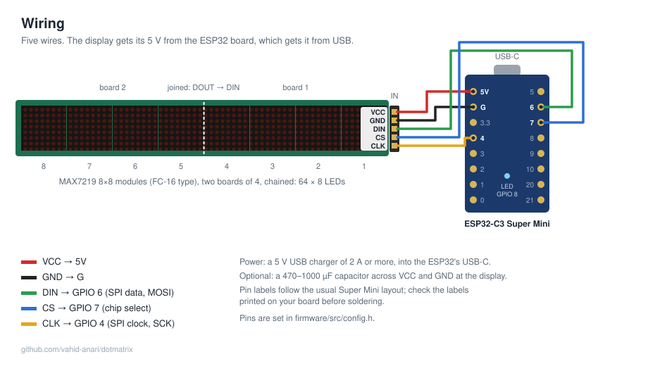

# Dot Matrix Display

A 64×8 LED matrix (eight 8×8 MAX7219 modules) on an ESP32-C3, controlled over Wi-Fi from an Android app.

- Text with 50 entry/exit effects, including sprites (Pacman, rocket, ...) and four laser effects
- Effects over a text while it stays: wave, sparkle, pulse, border
- Standalone animations: Matrix rain, Matrix reveal, starfield, Game of Life, fireworks, equalizer, snake, running sprite
- The app's editor previews each item, animated, the way the display plays it
- Clock synced from the internet, with automatic daylight saving and night dimming; the date and the weather outside scroll past now and then
- Light and dark look for the app, or as the phone is set
- Stopwatch and countdown timer that run on the display
- Works on its own after a power cut: the playlist is stored on the device
- Wi-Fi setup from any phone; app and firmware updates from GitHub Releases, installed from the phone

## Hardware

An ESP32-C3 Super Mini, two MAX7219 4-in-1 LED matrix boards and five wires. Parts, connections and tips: [docs/HARDWARE.md](docs/HARDWARE.md). A 3D-printable desk case is in [case/](case/).

## In this repository

| Folder | Contents |
|---|---|
| [`firmware/`](firmware/) | ESP32-C3 firmware (PlatformIO) |
| [`app/`](app/) | Android app (Flet) |
| [`tools/`](tools/) | `dm.py` command-line client, `fake_device.py` for testing without hardware, example playlists |
| [`case/`](case/) | 3D-printable desk case (OpenSCAD source and STL files) |
| [`docs/`](docs/DESIGN.md) | Design, protocol, roadmap; [hardware and wiring](docs/HARDWARE.md) |

## Planned

A temperature and humidity sensor, and signed firmware updates. See the [roadmap](docs/DESIGN.md#9-roadmap).

## Downloads

Each version (`v0.1.0`, …) has the Android app and the firmware under [Releases](../../releases), built by GitHub Actions: a push to `main` that raises the version releases it.

## Support

This is a free project I work on in my spare time. If you like it, you can [buy me a coffee](https://buymeacoffee.com/vahidanarim) ☕

## License

MIT, see [LICENSE](LICENSE). Uses [MD_Parola](https://github.com/MajicDesigns/MD_Parola) and [MD_MAX72XX](https://github.com/MajicDesigns/MD_MAX72XX) (LGPL-2.1); the sprite data comes from the MD_Parola examples.
