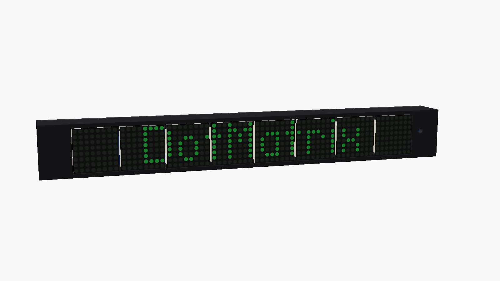
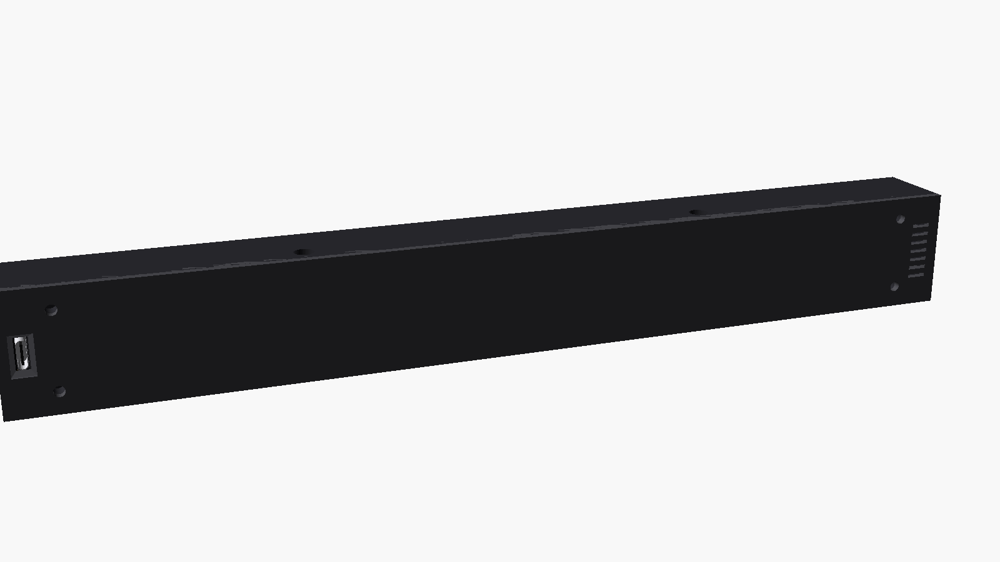
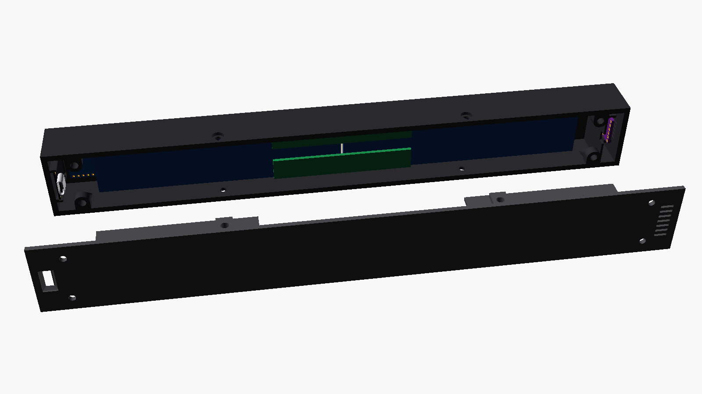
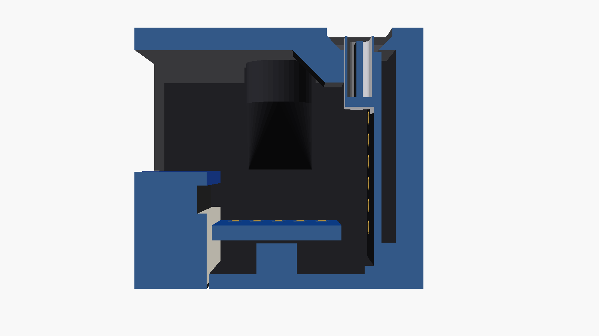

# Case

A 3D-printed case for the display, made to stand upright on a shelf: a body that
holds the two LED boards behind a window, the ESP32 and the two optional sensors,
and a back cover. Both print without supports.



| The back | Cover off |
|---|---|
|  |  |

The right end from above, cut through the ESP32: the light sensor behind its window
at the front, the ESP32 standing in its frame on the end wall, and its USB socket in
the cover's opening, with a small wall on the cover beside it.



To turn it around in 3D: open [`stl/assembled-preview.stl`](stl/assembled-preview.stl)
on GitHub (or press space on it in the Mac's Finder). It's the whole thing put
together, with the boards, only for looking at.

## Print

| Part | File | On the bed |
|---|---|---|
| Body | `stl/case.stl` | front face down, **diagonally** |
| Back cover | `stl/cover.stl` | outside down, diagonally |

Both are 310.6 × 38.4 mm (the body 25.7 deep, the cover 15.4). That's longer than a
256 mm bed (Bambu A1, P1S, X1), but they fit when turned diagonally in the slicer. No
supports and no brim needed. PLA, 0.2 mm layers. The front is printed on the bed, so a
textured plate gives it a textured finish.

The window is the LED blocks' size plus 0.25 mm on each side, and nothing covers the
LEDs. Before printing the whole body, the small test pieces check the fit on your
printer and your boards:

| Test | Checks |
|---|---|
| `stl/test_frame.stl` | the first 2 mm of the front: the window around the LED blocks |
| `stl/test_end.stl`, `stl/test_cover.stl` | the right end: ESP32 frame, light sensor posts, USB opening |
| `stl/test_end_l.stl`, `stl/test_cover_l.stl` | the left end: the BME280's drawer and vents |

## You also need

- 10 × M3×6 button head screws.
- 8 × M3 brass heat-set inserts, 4.2 mm across and 5 mm long: 4 in the body's corner
  bosses, 4 in the cover's tabs.

## Put it together

1. Press the inserts in with a soldering iron: four into the bosses in the body's
   corners, four into the tabs on the cover.
2. Slide the display in from the back, LEDs to the front, its **IN** end on the
   right when you look at the front. It fills the whole height; the thin fins between
   the LED blocks hold it.
3. Wire everything ([wiring](../docs/HARDWARE.md)). On the ESP32, solder the wires on
   the side with the chip: only 1.5 mm is left behind the board.
4. Slide the ESP32 into its frame on the right end wall, USB towards the back. Its
   front end goes under two small lips; the cover holds the USB end.
5. Screw the light sensor (GY-302) onto its two posts behind the small window on the
   right, chip to the front, with 2 of the screws.
6. Slide the BME280 into its drawer on the left end, behind the vents. Its wires go
   through the slot in the wall beside it.
7. Put the cover on, USB socket in its opening. Four screws go in from the back into
   the corners, and four through the top and bottom into the cover's tabs.

## Change it

The model is [`dotmatrix_case.scad`](dotmatrix_case.scad), for
[OpenSCAD](https://openscad.org). The sizes of the boards are at the top. It uses the
board models from [partbin](https://github.com/vahid-anari/partbin), a submodule
here:

```sh
git submodule update --init
./render.sh    # STL files into stl/, pictures into images/
```

or open `dotmatrix_case.scad` in OpenSCAD, set `part` at the top (`case`, `cover`,
a test piece, or `all` / `open` / `section` to look at it), press F6 and export.
