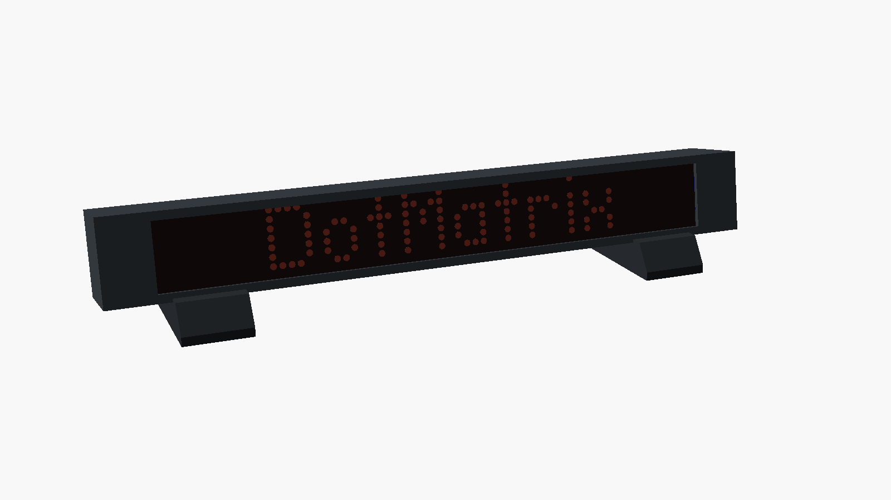
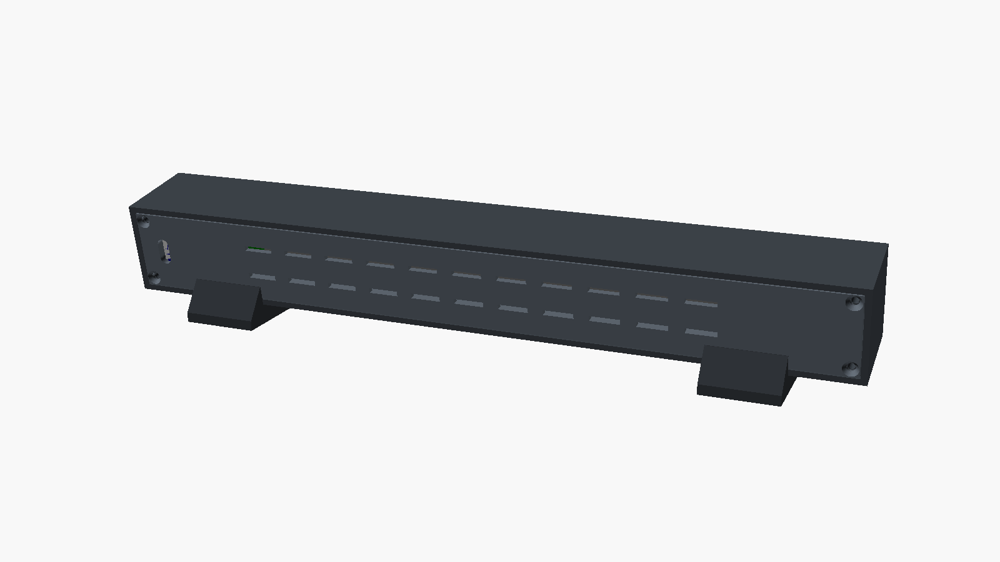
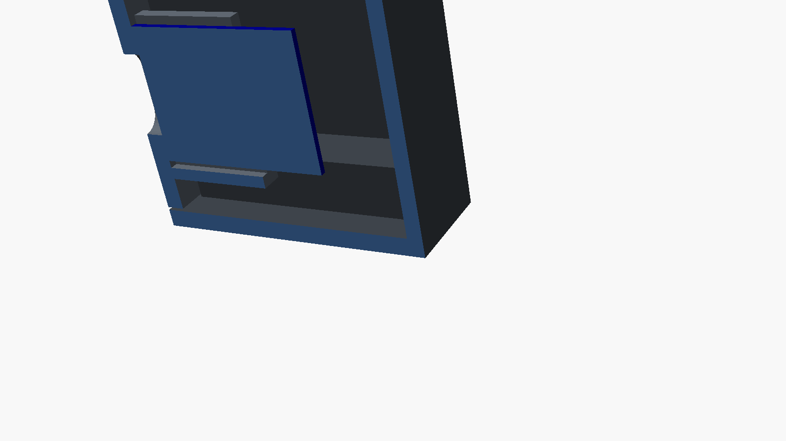
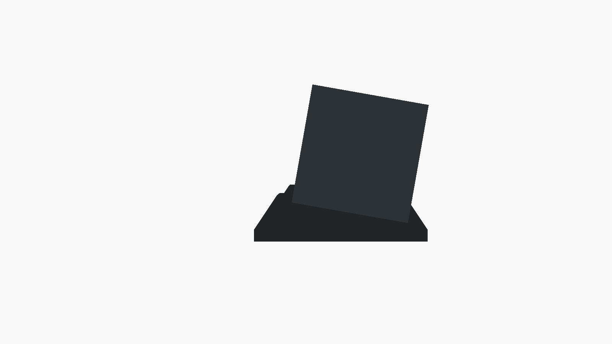

# Desk case

A 3D-printed case for the display: a front shell, a back cover that holds the ESP32, and two feet that lean it back by 10°.




| Cut through the right end | From the side |
|---|---|
|  |  |

To turn it around in 3D: open [`stl/assembled-preview.stl`](stl/assembled-preview.stl) on GitHub (or press space on it in the Mac's Finder). It's the whole thing put together, with the display and the ESP32, only for looking at.

**First version, drawn from typical FC-16 sizes.** Measure your boards and put the numbers at the top of `dotmatrix_case.scad` before printing (see below).

## Print

| Part | File | How many | On the bed |
|---|---|---|---|
| Front shell | `stl/shell.stl` | 1 | face down, **diagonally** |
| Back cover | `stl/back.stl` | 1 | outside down, diagonally |
| Foot | `stl/foot.stl` | 2 | as exported |

The shell is about 298 × 37 × 38 mm. It's longer than a 256 mm bed (Bambu A1, P1S, X1), but fits easily when you turn it diagonally in the slicer. No supports needed.

PLA or PETG, 0.2 mm layers, 3 walls, 15 % infill. The front face is printed on the bed, so a textured plate gives it a textured finish. A brim helps keep the long thin parts flat.

## You also need

- 4 × M3 screws, 8–10 mm. Countersunk heads sit flush with the back cover; cap screws work too and stick out a little. They cut their own thread in the printed holes.
- Optional: a 2 mm tinted (smoked grey) acrylic sheet, 256.8 × 32.8 mm. Behind it only the lit LEDs show and the rest looks black. Without it you see the LED blocks directly.

## Put it together

1. If you use acrylic, lay it in the shell against the front.
2. Put the display in, LEDs to the front, with its **IN** end on the right when you look at the front (the end with the USB opening in the back cover).
3. Wire the display to the ESP32 ([wiring](../docs/HARDWARE.md)).
4. Slide the ESP32 into the rails on the back cover, USB-C towards the cover's opening.
5. Close the back cover with the 4 screws. Its two long ribs press the display against the front.
6. Stand it in the feet.

## Measure these, and change the numbers

At the top of `dotmatrix_case.scad`:

| Setting | What to measure | Typical |
|---|---|---|
| `disp_len` | both boards side by side, end to end | 256.0 |
| `disp_h` | height of a board | 32.0 |
| `led_depth` | front of the LEDs to the front of the PCB | 9.0 |
| `pcb_t` | the PCB | 1.6 |
| `behind_pcb` | how far chips and pins stick out behind the PCB | 6.0 |
| `esp_w`, `esp_l` | the ESP32 board | 18.0, 22.6 |

Also there: `acrylic` (0 without the sheet), `tilt`, wall thickness, and the room behind the display.

Then make the files again, with [OpenSCAD](https://openscad.org):

```sh
./render.sh    # STL files into stl/, pictures into images/
```

or open `dotmatrix_case.scad` in OpenSCAD, set `part` at the top to `shell`, `back` or `foot`, press F6 and export.

## Later

Places for the temperature/humidity and light sensors: a vented pocket for the BME280 away from the warm parts, and a small window for the light sensor facing the room.
