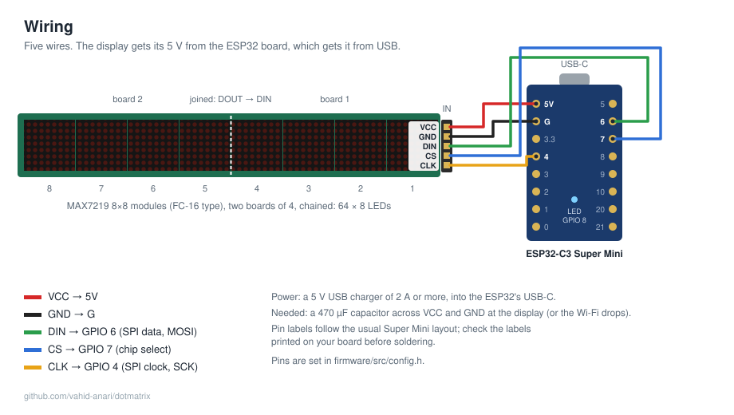
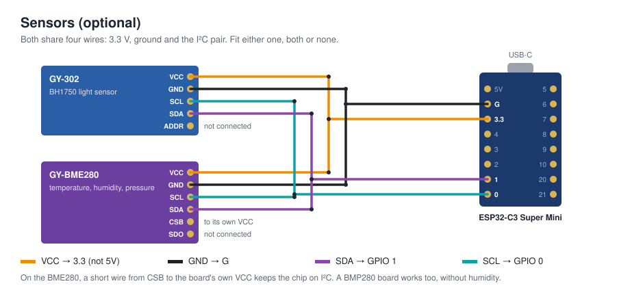

# Hardware

## Parts

| Part | Notes |
|---|---|
| ESP32-C3 Super Mini | The small board with USB-C. Any ESP32-C3 works if you change the pins in `firmware/src/config.h`. |
| 2 × MAX7219 4-in-1 8×8 LED matrix (FC-16 type) | Together 64 × 8 LEDs. Eight single modules chained work too. |
| 5 wires | Dupont jumper wires, or soldered. Keep them short (under ~20 cm) and the clock wire away from the power wires. |
| 5 V USB charger, 2 A or more, and a USB-C cable | The display draws everything through the ESP32 board. |
| Optional: GY-BME280 and GY-302 (BH1750) | Temperature, humidity and air pressure, and light; see below. |
| 470 µF electrolytic capacitor, 10 V or more (one at the input; on the 8-module display, two more along it help) | Across VCC and GND on the back of the display, minus to GND. **Needed for the Wi-Fi**, see below. |

## Connections

| Display (IN side) | ESP32-C3 Super Mini | What it is |
|---|---|---|
| VCC | 5V | Power for the LEDs |
| GND | G | Ground |
| DIN | GPIO 6 | SPI data (MOSI) |
| CS | GPIO 7 | Chip select |
| CLK | GPIO 4 | SPI clock (SCK) |

The on-board LED (GPIO 8) shows the Wi-Fi state; nothing to connect.

### Optional sensors

A light sensor and a temperature/humidity/pressure sensor can share two more wires (I²C). Each is optional; the firmware finds whatever is fitted when it starts, and looks again every half minute.

| Sensor | Pin | ESP32-C3 Super Mini |
|---|---|---|
| GY-302 (BH1750) light sensor | VCC | 3.3 |
| | GND | G |
| | SCL | GPIO 0 |
| | SDA | GPIO 1 |
| | ADDR | not connected |
| GY-BME280 (temperature, humidity, pressure; a BMP280 board works too, without humidity) | VCC | 3.3 |
| | GND | G |
| | SCL | GPIO 0 |
| | SDA | GPIO 1 |
| | CSB | to the board's own VCC (keeps it on I²C) |
| | SDO | not connected (either address is found) |

Both run on 3.3 V, not 5 V. The readings go to the app with the display's state.

The display has an **IN** side and an **OUT** side. The wires go to IN, on the module at the right-hand end when you look at the LEDs. The two 4-module boards are joined OUT → IN (VCC to VCC, GND to GND, DOUT to DIN, CS to CS, CLK to CLK), usually by soldering the pins straight across.

## Things to know

- **Power.** Each MAX7219 can draw up to about 0.3 A with every LED on at full brightness, so the worst case for eight is over 2 A. Normal text at the default brightness (6 of 15) needs far less, a few hundred mA. A weak charger or a long thin cable can make the display flicker or the ESP32 restart; then use a stronger charger, a shorter cable, or the capacitor above. Night dimming helps too.
- **3.3 V signals into a 5 V display.** The ESP32's pins are 3.3 V and the MAX7219 runs at 5 V. That works with almost every FC-16 module. If the display shows garbage only now and then, shorten the wires first; a 74AHCT125 level shifter on DIN, CS and CLK is the full fix.
- **Pin labels.** The drawing follows the usual Super Mini layout (USB at the top, 5V / G / 3.3 / 4 … 0 down the left, 5 … 21 down the right). Some clones differ, so go by the labels printed on your board.
- **Mirrored or upside-down text.** If the firmware's own drawings (clock, animations) look mirrored while Parola's text effects look right, set `DISPLAY_FLIP_X` in `firmware/src/config.h`. If everything is upside down, turn the display around: the IN side must be on the right.
- **Wi-Fi drops.** The MAX7219s switch the LED current on and off about 800 times a second. Without a big capacitor at the display, those spikes reach the ESP32 through the shared 5 V and its radio misses the router's signals: the Wi-Fi drops about once a minute even right next to the router, at any brightness. The 470 µF capacitor above fixes it (tested: from a drop a minute to none, at full brightness). If the History page's Events still show many drops, add more along the display, or feed the display's VCC straight from the USB supply rather than through the ESP32 board's 5V pin.
- Many Super Mini boards also have a weak antenna, so the firmware limits the Wi-Fi power to 8.5 dBm. Keep the board's antenna end (opposite the USB) away from the metal of the display if you can.

## Flashing

See [firmware/README.md](../firmware/README.md). After the first USB flash, updates go over Wi-Fi from the app.
